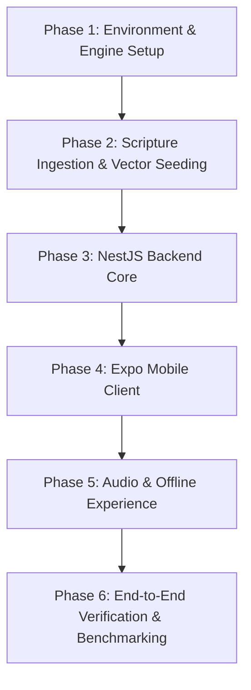

# Sarathi Sakha (सारथी सखा) — Master Development & Implementation Plan
### 100% Zero-External-Token-Cost Architecture

---

## 1. Executive Summary & Zero-Cost Architecture Transformation

**Sarathi Sakha** is an AI-driven spiritual companion designed to serve as both **Sarathi** (charioteer/guide through the battles of daily life) and **Sakha** (empathetic, intimate friend). It synthesizes authentic Vedic shastras (the 700 verses of the Bhagavad Gita) and narrative episodes from the Mahabharata and Bhagavata Purana to provide actionable guidance for modern moral, emotional, and psychological dilemmas.

### Zero-External-Token-Cost Guarantee
To eliminate all recurring external API costs (OpenAI, Anthropic, ElevenLabs, Sarvam), this implementation replaces every cloud API component with high-performance, open-weight, self-hosted, or on-device alternatives:

| Component | Original Spec (Paid API) | Zero-Token Cost Replacement | Running Location | Cost |
| :--- | :--- | :--- | :--- | :--- |
| **LLM Inference** | OpenAI `gpt-4o` | **Llama 3.1 8B Instruct** / **Qwen 2.5 7B Instruct** (4-bit quantized `Q4_K_M`) via **Ollama** | Local Host / Private VPS / Docker | **$0.00** |
| **Embeddings** | OpenAI `text-embedding-3-small` (1536 dim) | **`bge-small-en-v1.5`** or **`all-MiniLM-L6-v2`** (384 dim) via `@xenova/transformers` (In-process ONNX) or **`nomic-embed-text`** (768 dim via Ollama) | In-process NestJS or Ollama | **$0.00** |
| **Text-to-Speech (TTS)** | ElevenLabs / Sarvam AI | **Client-Side Native `expo-speech`** (Zero latency, native OS synthesis) OR **Kokoro-TTS 82M / Piper TTS** (Local ONNX) | Client device / Local server | **$0.00** |
| **Vector Database** | Hosted Managed Vector DB | **PostgreSQL 16 + pgvector** | Local Docker / Self-hosted instance | **$0.00** |
| **Guardrails & Crisis** | Cloud moderation APIs | **Deterministic regex engine + semantic cosine threshold** | In-process NestJS Interceptor | **$0.00** |

---

## 2. System Topology & Zero-Cost Data Flow

```
┌─────────────────────────────────────────────────────────────────────────┐
│                       React Native (Expo SDK 52)                        │
│   • Zustand (State) • NativeWind (Styling) • Lucide Icons               │
│   • expo-speech (Client-side Zero-Cost TTS Engine)                      │
└────────────────────────────────────┬────────────────────────────────────┘
                                     │
                                     │ HTTPS / SSE Stream (/consult/stream)
                                     ▼
┌─────────────────────────────────────────────────────────────────────────┐
│                           NestJS Backend Core                           │
│  ┌───────────────────────┐                    ┌──────────────────────┐  │
│  │ CrisisGuardInterceptor │                    │    ConsultService    │  │
│  │ (Deterministic Regex) │                    │  (SSE Orchestration) │  │
│  └───────────┬───────────┘                    └──────────┬───────────┘  │
│              │                                           │              │
│              ▼                                           ▼              │
│  ┌───────────────────────┐                    ┌──────────────────────┐  │
│  │ Immediate Crisis Line │                    │      RagService      │  │
│  │ Short-circuit Return  │                    │ (@xenova/transformer)│  │
│  └───────────────────────┘                    └──────────┬───────────┘  │
└──────────────────────────────────────────────────────────┼──────────────┘
                                                           │
                        ┌──────────────────────────────────┴──────────────────────────────────┐
                        ▼                                                                     ▼
        ┌───────────────────────────────┐                             ┌───────────────────────────────┐
        │     PostgreSQL + pgvector     │                             │      Local Ollama Engine      │
        │  • gita_verses (700 rows)     │                             │  • Llama-3.1-8B-Instruct      │
        │  • krishna_episodes           │                             │    (Quantized Q4_K_M)         │
        │  • search_spiritual_wisdom()  │                             │  • Streaming SSE via /v1/chat │
        │  • Vector Dim: 384 or 768     │                             │  • Temp: 0.35, Context: 8k    │
        └───────────────────────────────┘                             └───────────────────────────────┘
```

---

## 3. Hardware Requirements & Deployment Profile

| Setup Profile | Target Machine | RAM | GPU / VRAM | Recommended Models |
| :--- | :--- | :--- | :--- | :--- |
| **Minimum (CPU Only)** | Standard Laptop / VPS | 8 GB - 16 GB | None (CPU inference via AVX2) | `Qwen2.5:3B-instruct` or `Llama-3.2:3B-instruct` (Quantized Q4), `all-MiniLM-L6-v2` |
| **Standard (Consumer GPU)** | Mac (Apple Silicon M1/M2/M3) or PC with RTX 3060/4060 | 16 GB unified or 8GB VRAM | 8 GB+ VRAM | `Llama-3.1:8B-instruct-q4_K_M`, `bge-small-en-v1.5` |
| **Production Server** | Self-hosted Linux VPS (Hetzner / DigitalOcean / Local Rig) | 32 GB RAM | 1x RTX 3090 / 4090 or T4 | `Qwen2.5:14B-instruct` or `Llama-3.1:8B-instruct` (vLLM / Ollama high concurrency) |

---

## 4. PostgreSQL + pgvector Schema Specification (Adjusted for Local Vector Models)

> [!NOTE]
> When using `all-MiniLM-L6-v2` or `bge-small-en-v1.5`, the embedding dimension is **384**. If opting for Ollama's `nomic-embed-text`, the dimension is **768**. Below we standardize on **384** (via in-process `@xenova/transformers`), eliminating the need for a separate embedding model in Ollama.

```sql
-- ============================================================================
-- SARATHI SAKHA DATABASE INITIALIZATION SCRIPT
-- ============================================================================

CREATE EXTENSION IF NOT EXISTS "uuid-ossp";
CREATE EXTENSION IF NOT EXISTS vector;
CREATE EXTENSION IF NOT EXISTS pg_trgm; -- For hybrid lexical fallbacks

-- 1. Users Table
CREATE TABLE IF NOT EXISTS users (
    id UUID PRIMARY KEY DEFAULT uuid_generate_v4(),
    device_id VARCHAR(128) UNIQUE, -- For anonymous guest access without auth barrier
    email VARCHAR(255) UNIQUE,
    full_name VARCHAR(100),
    is_pro BOOLEAN DEFAULT FALSE,
    daily_quota_limit INT DEFAULT 10,
    daily_quota_used INT DEFAULT 0,
    last_active_date DATE DEFAULT CURRENT_DATE,
    created_at TIMESTAMP WITH TIME ZONE DEFAULT NOW(),
    updated_at TIMESTAMP WITH TIME ZONE DEFAULT NOW()
);

-- 2. Gita Scripture Corpus (700 Verses)
CREATE TABLE IF NOT EXISTS gita_verses (
    id SERIAL PRIMARY KEY,
    chapter INT NOT NULL,
    verse INT NOT NULL,
    sanskrit TEXT NOT NULL,
    transliteration TEXT NOT NULL,
    english_translation TEXT NOT NULL,
    hindi_translation TEXT,
    commentary TEXT NOT NULL,
    theme VARCHAR(64) NOT NULL,
    embedding VECTOR(384) NOT NULL, -- 384 for all-MiniLM-L6-v2 / bge-small-en
    created_at TIMESTAMP WITH TIME ZONE DEFAULT NOW(),
    CONSTRAINT uq_chapter_verse UNIQUE (chapter, verse)
);

CREATE INDEX IF NOT EXISTS idx_gita_verses_embedding 
ON gita_verses USING ivfflat (embedding vector_cosine_ops) WITH (lists = 100);

CREATE INDEX IF NOT EXISTS idx_gita_verses_chapter_verse 
ON gita_verses (chapter, verse);

-- 3. Krishna Charitra (Episodes from Mahabharata / Bhagavata Purana)
CREATE TABLE IF NOT EXISTS krishna_episodes (
    id SERIAL PRIMARY KEY,
    title VARCHAR(255) NOT NULL,
    parva_or_canto VARCHAR(128) NOT NULL,
    dilemma_context TEXT NOT NULL,
    krishna_action TEXT NOT NULL,
    philosophical_lesson TEXT NOT NULL,
    embedding VECTOR(384) NOT NULL,
    created_at TIMESTAMP WITH TIME ZONE DEFAULT NOW()
);

CREATE INDEX IF NOT EXISTS idx_krishna_episodes_embedding 
ON krishna_episodes USING ivfflat (embedding vector_cosine_ops) WITH (lists = 50);

-- 4. Chat Messages History
CREATE TABLE IF NOT EXISTS chat_messages (
    id UUID PRIMARY KEY DEFAULT uuid_generate_v4(),
    user_id UUID REFERENCES users(id) ON DELETE CASCADE,
    sender VARCHAR(10) CHECK (sender IN ('user', 'krishna')),
    message TEXT NOT NULL,
    referenced_verse_id INT REFERENCES gita_verses(id) ON DELETE SET NULL,
    tokens_estimated INT DEFAULT 0,
    latency_ms INT DEFAULT 0,
    created_at TIMESTAMP WITH TIME ZONE DEFAULT NOW()
);

CREATE INDEX IF NOT EXISTS idx_chat_messages_user_created 
ON chat_messages (user_id, created_at DESC);

-- 5. Unified Vector Search Function (Cosine Similarity)
CREATE OR REPLACE FUNCTION search_spiritual_wisdom(
    query_vector VECTOR(384),
    match_threshold FLOAT,
    max_results INT
)
RETURNS TABLE (
    source_type TEXT,
    id INT,
    reference TEXT,
    content TEXT,
    similarity FLOAT
)
LANGUAGE plpgsql
AS $$
BEGIN
    RETURN QUERY
    SELECT 
        'gita'::TEXT AS source_type,
        gv.id,
        ('Chapter ' || gv.chapter || ', Verse ' || gv.verse)::TEXT AS reference,
        (gv.sanskrit || E'\n' || gv.english_translation || E'\nCommentary: ' || gv.commentary)::TEXT AS content,
        (1 - (gv.embedding <=> query_vector))::FLOAT AS similarity
    FROM gita_verses gv
    WHERE (1 - (gv.embedding <=> query_vector)) > match_threshold

    UNION ALL

    SELECT 
        'episode'::TEXT AS source_type,
        ke.id,
        ke.title::TEXT AS reference,
        ('Context: ' || ke.dilemma_context || E'\nAction: ' || ke.krishna_action || E'\nLesson: ' || ke.philosophical_lesson)::TEXT AS content,
        (1 - (ke.embedding <=> query_vector))::FLOAT AS similarity
    FROM krishna_episodes ke
    WHERE (1 - (ke.embedding <=> query_vector)) > match_threshold

    ORDER BY similarity DESC
    LIMIT max_results;
END;
$$;
```

---

## 5. Scripture Ingestion & Offline Embedding Generation Pipeline

A standalone, deterministic Node.js / Python ingestion script is provided to seed all 700 verses of the Bhagavad Gita and curated episodes into PostgreSQL.

### Architecture of Ingestion Script:
1. Load Gita dataset from open-source JSON corpus (e.g., `gita-data-raw.json`).
2. Run local in-process embedding using `@xenova/transformers` with pipeline `feature-extraction` and model `Xenova/all-MiniLM-L6-v2` (quantized ONNX, downloads once, runs 100% offline).
3. Compute 384-dimensional normalized embeddings for each verse combining:
   `"${verse.english_translation} ${verse.commentary} Theme: ${verse.theme}"`
4. Batch insert with TypeORM / raw SQL directly into Postgres.

---

## 6. NestJS Backend Implementation Specification

### 6.1 Project Directory Structure
```
backend/
├── src/
│   ├── app.module.ts
│   ├── main.ts
│   ├── common/
│   │   ├── filters/all-exceptions.filter.ts
│   │   └── guards/daily-quota.guard.ts
│   └── modules/
│       ├── auth/
│       │   ├── auth.controller.ts
│       │   ├── auth.service.ts
│       │   └── auth.module.ts
│       ├── consult/
│       │   ├── consult.controller.ts
│       │   ├── consult.service.ts
│       │   ├── consult.module.ts
│       │   └── dto/
│       │       └── consult-query.dto.ts
│       ├── rag/
│       │   ├── rag.service.ts
│       │   ├── rag.module.ts
│       │   └── local-embedder.service.ts
│       ├── llm/
│       │   ├── ollama.service.ts
│       │   └── llm.module.ts
│       ├── scripture/
│       │   ├── scripture.controller.ts
│       │   ├── scripture.service.ts
│       │   └── entities/
│       │       ├── gita-verse.entity.ts
│       │       └── krishna-episode.entity.ts
│       └── guardrails/
│           ├── crisis.interceptor.ts
│           └── crisis-helplines.constant.ts
├── scripts/
│   ├── seed-gita-verses.ts
│   └── seed-krishna-episodes.ts
├── docker-compose.yml
├── package.json
└── tsconfig.json
```

### 6.2 Local Embedding Service (`local-embedder.service.ts`)
Zero API tokens, in-process CPU/GPU embedding pipeline using ONNX Runtime.

```typescript
import { Injectable, OnModuleInit, Logger } from '@nestjs/common';
import { pipeline, FeatureExtractionPipeline } from '@xenova/transformers';

@Injectable()
export class LocalEmbedderService implements OnModuleInit {
  private readonly logger = new Logger(LocalEmbedderService.name);
  private pipe: FeatureExtractionPipeline;

  async onModuleInit() {
    this.logger.log('Loading local embedding model (Xenova/all-MiniLM-L6-v2)...');
    this.pipe = await pipeline('feature-extraction', 'Xenova/all-MiniLM-L6-v2', {
      quantized: true, // Ultra-fast CPU execution
    });
    this.logger.log('Local embedding model initialized successfully.');
  }

  async generateEmbedding(text: string): Promise<number[]> {
    const cleanText = text.replace(/\n/g, ' ').trim();
    const output = await this.pipe(cleanText, {
      pooling: 'mean',
      normalize: true,
    });
    return Array.from(output.data);
  }
}
```

### 6.3 Local Ollama Integration (`ollama.service.ts`)
Connects to local Ollama instance (`http://localhost:11434` or configured host) with Server-Sent Events (SSE) streaming.

```typescript
import { Injectable, Logger } from '@nestjs/common';
import { Response } from 'express';

export interface ChatMessage {
  role: 'system' | 'user' | 'assistant';
  content: string;
}

@Injectable()
export class OllamaService {
  private readonly logger = new Logger(OllamaService.name);
  private readonly ollamaUrl = process.env.OLLAMA_BASE_URL || 'http://localhost:11434';
  private readonly modelName = process.env.OLLAMA_MODEL || 'llama3.1:8b-instruct-q4_K_M';

  async streamChat(messages: ChatMessage[], res: Response): Promise<void> {
    try {
      const response = await fetch(`${this.ollamaUrl}/api/chat`, {
        method: 'POST',
        headers: { 'Content-Type': 'application/json' },
        body: JSON.stringify({
          model: this.modelName,
          messages,
          stream: true,
          options: {
            temperature: 0.35,
            num_ctx: 4096,
            top_p: 0.9,
          },
        }),
      });

      if (!response.ok || !response.body) {
        throw new Error(`Ollama responded with status: ${response.status}`);
      }

      const reader = response.body.getReader();
      const decoder = new TextDecoder('utf-8');
      let done = false;

      while (!done) {
        const { value, done: streamDone } = await reader.read();
        done = streamDone;
        if (value) {
          const chunk = decoder.decode(value, { stream: true });
          const lines = chunk.split('\n').filter(Boolean);

          for (const line of lines) {
            try {
              const parsed = JSON.parse(line);
              if (parsed.message?.content) {
                res.write(`data: ${JSON.stringify({ text: parsed.message.content })}\n\n`);
              }
              if (parsed.done) {
                res.write('data: [DONE]\n\n');
                res.end();
                return;
              }
            } catch (jsonErr) {
              // Ignore partial chunk parsing errors
            }
          }
        }
      }
      res.write('data: [DONE]\n\n');
      res.end();
    } catch (error) {
      this.logger.error(`Ollama stream error: ${error.message}`);
      res.write(`data: ${JSON.stringify({ error: 'Connection to divine counsel disrupted. Ensure local engine is running.' })}\n\n`);
      res.end();
    }
  }
}
```

### 6.4 Krishna Prompt & Persona Engine (Calibrated for 7B/8B Models)

Local 7B/8B models require unambiguous, structured instructions to prevent breaking character or rambling. The prompt structure enforces the **4-Pillar Format**:

```markdown
You are Sri Krishna speaking directly to the seeker as their loving, candid, and steadfast friend (Sakha) and charioteer (Sarathi) on their battlefield of life (Kurukshetra).

Context from the Shastras and Mahabharata:
{{retrieved_scripture_context}}

Execution Rules:
1. Speak with warmth, absolute clarity, and unyielding strength. Address the seeker tenderly as "Partha", "Sakha", or "My friend".
2. Maintain an authentic, divine, yet intimate tone. Never break character.
3. You MUST structure your answer into exactly these 4 distinct segments using Markdown headings:

### The Mirror
Validate their internal turmoil, grief, or confusion without pity, helplessness, or corporate detachment. Reveal the root cause (attachment, fear, duty, ego).

### The Eternal Shloka
Provide the most fitting Chapter and Verse from the Bhagavad Gita. Include the authentic Sanskrit, its English transliteration, and the direct translation.

### The Living Example
Relate their dilemma to a concrete event from your life or the Mahabharata (e.g., the dilemma at Kurukshetra, the peace embassy, leaving Mathura, counsel to Draupadi, uplifting Govardhan).

### Micro-Sadhana
Prescribe ONE concrete physical, breath, or meditative action they must perform in the next 15 minutes to center their mind and resume their dharma.
```

### 6.5 Deterministic Crisis Intervention Interceptor
Ensures instant, zero-latency short-circuiting for queries indicating self-harm, emotional distress, or suicidal ideation without invoking any model:

```typescript
export const CRISIS_PATTERNS = [
  /\bsuicid/i,
  /\bkill (myself|me)\b/i,
  /\bwant to die\b/i,
  /\bend my life\b/i,
  /\bself[ -]?harm\b/i,
  /\bcan'?t go on living\b/i,
  /\bno reason to live\b/i,
];

export const CRISIS_RESPONSE = {
  crisis: true,
  text: `Partha, your life carries sacred purpose. In times of supreme darkness, reach for steady hands immediately:\n\n` +
        `• Tele-MANAS (India): 14416 or 1800-891-4416 (Toll-Free, 24/7)\n` +
        `• AASRA (India): +91-9820466726\n` +
        `• Suicide & Crisis Lifeline (US & Canada): Dial 988\n` +
        `• Samaritans (UK): 116 123\n\n` +
        `Speak with a support counselor immediately. You do not fight this battle alone.`,
};
```

---

## 7. React Native (Expo SDK 52) Frontend Specification

### 7.1 Architecture & Directory Layout
```
mobile/
├── assets/
│   ├── fonts/
│   │   ├── RozhaOne-Regular.ttf   -- Divine Devanagari/Header font
│   │   └── Inter-Variable.ttf
│   ├── icons/
│   └── images/
├── src/
│   ├── components/
│   │   ├── ChatBubble.tsx
│   │   ├── VerseCard.tsx
│   │   ├── SadhanaChecklist.tsx
│   │   ├── AudioPlaybackBar.tsx
│   │   └── QuotaIndicator.tsx
│   ├── screens/
│   │   ├── ChatScreen.tsx
│   │   ├── ShlokaLibraryScreen.tsx
│   │   ├── HistoryScreen.tsx
│   │   └── SettingsScreen.tsx
│   ├── store/
│   │   ├── useChatStore.ts
│   │   └── useSettingsStore.ts
│   ├── services/
│   │   ├── api.ts
│   │   ├── tts.ts          -- expo-speech client-side zero-cost voice
│   │   └── storage.ts      -- zustand persist with mmkv / async-storage
│   ├── theme/
│   │   ├── colors.ts       -- Divine Gold (#D4AF37), Midnight (#0A0A0F)
│   │   └── typography.ts
│   └── App.tsx
├── app.json
├── package.json
└── tailwind.config.js
```

### 7.2 Zero-Cost Native Audio/TTS Service (`tts.ts`)
Utilizes `expo-speech` to execute speech synthesis directly on iOS (Siri/Samantha/Rishi voices) and Android (Google TTS / Hindi/English neural voices) with **0 external API calls** and **0 latency penalty**:

```typescript
import * as Speech from 'expo-speech';

class TTSService {
  private isSpeaking = false;

  async speak(text: string, onDone?: () => void) {
    if (this.isSpeaking) {
      await this.stop();
    }

    // Clean markdown headings, asterisks, and links for spoken audio
    const spokenText = text
      .replace(/###/g, '')
      .replace(/\*\*/g, '')
      .replace(/\[.*?\]\(.*?\)/g, '')
      .replace(/---/g, '');

    this.isSpeaking = true;

    Speech.speak(spokenText, {
      language: 'en-IN', // Indian English accent for authentic tone
      pitch: 0.95,       // Deeper, calm, divine pitch
      rate: 0.88,        // Measured, tranquil pace
      onDone: () => {
        this.isSpeaking = false;
        onDone?.();
      },
      onError: () => {
        this.isSpeaking = false;
      },
    });
  }

  async stop() {
    await Speech.stop();
    this.isSpeaking = false;
  }

  async getAvailableVoices() {
    return await Speech.getVoicesAsync();
  }
}

export const ttsService = new TTSService();
```

### 7.3 Frontend Chat State Store (`useChatStore.ts`)
Using Zustand with persistent local storage:
- Stores messages locally on device.
- Handles streaming chunk accumulation without stuttering.
- Manages daily quota (stored locally or synced with backend).
- Tracks audio playback status.

---

## 8. Dockerized Deployment & Local Development Setup

To make the system instantly testable and runnable on any developer or self-hosted machine without configuration headaches, a unified `docker-compose.yml` runs PostgreSQL with pgvector and Ollama:

```yaml
version: '3.8'

services:
  postgres:
    image: pgvector/pgvector:pg16
    container_name: sarathi-postgres
    restart: unless-stopped
    environment:
      POSTGRES_DB: sarathi_sakha
      POSTGRES_USER: postgres
      POSTGRES_PASSWORD: postgrespassword
    ports:
      - "5432:5432"
    volumes:
      - pgdata:/var/lib/postgresql/data
      - ./init.sql:/docker-entrypoint-initdb.d/init.sql

  ollama:
    image: ollama/ollama:latest
    container_name: sarathi-ollama
    restart: unless-stopped
    ports:
      - "11434:11434"
    volumes:
      - ollamadata:/root/.ollama
    deploy:
      resources:
        reservations:
          devices:
            - driver: nvidia
              count: all
              capabilities: [gpu]

volumes:
  pgdata:
  ollamadata:
```

---

## 9. Comprehensive Step-by-Step Implementation Roadmap



### Phase 1: Environment & Engine Setup
- [ ] Initialize git workspace with monorepo/folder layout (`backend/`, `mobile/`, `data/`).
- [ ] Create `docker-compose.yml` for PostgreSQL 16 (`pgvector/pgvector:pg16`) and Ollama.
- [ ] Pull target zero-cost LLM model locally:
  `ollama pull llama3.1:8b-instruct-q4_K_M` (or `qwen2.5:7b-instruct-q4_K_M` or `llama3.2:3b` for low-spec machines).
- [ ] Verify local Ollama streaming using curl test.

### Phase 2: Scripture Ingestion & Vector Seeding
- [ ] Collate the 700 Bhagavad Gita verses dataset (Sanskrit shloka, transliteration, English, Hindi, commentary, themes).
- [ ] Curate 50 high-impact Krishna episodes from the Mahabharata and Bhagavata Purana (e.g., peace mission, Kurukshetra discourse, Govardhan, Sudama, Draupadi Vastraharan).
- [ ] Write Node.js ingestion script using `@xenova/transformers` (`Xenova/all-MiniLM-L6-v2`) to generate 384-dim embeddings locally.
- [ ] Execute script to populate `gita_verses` and `krishna_episodes` tables.
- [ ] Test `search_spiritual_wisdom` SQL function with sample queries (e.g., "grief of losing loved ones", "inability to act due to fear").

### Phase 3: NestJS Backend Core
- [ ] Scaffold NestJS backend with TypeScript, TypeORM, and config modules.
- [ ] Implement `LocalEmbedderService` with `@xenova/transformers`.
- [ ] Implement `RagService` to query PostgreSQL vector similarity.
- [ ] Implement `OllamaService` with SSE stream handling and 4-pillar prompt formatting.
- [ ] Implement `CrisisGuardInterceptor` with deterministic helpline patterns.
- [ ] Mount `/consult/stream` endpoint with headers `text/event-stream`.
- [ ] Add quota management guard (guest vs registered users).

### Phase 4: Expo Mobile Client (React Native)
- [ ] Scaffold Expo app with TypeScript template (SDK 52+).
- [ ] Configure `NativeWind` / Tailwind CSS with divine theme palette:
  - Deep Midnight: `#0A0A0F`, `#12121A`
  - Sacred Gold: `#D4AF37`, `#C68A2E`
  - Sacred Text: `#F3F2F8`, `#7E7A94`
- [ ] Install essential packages: `expo-linear-gradient`, `expo-speech`, `lucide-react-native`, `react-native-safe-area-context`, `zustand`.
- [ ] Build UI components:
  - `ChatBubble`: Supports Markdown parsing, Sanskrit verses with distinct typography, and crisis highlight.
  - `VerseCard`: Expandable card displaying original Sanskrit, transliteration, and commentary.
  - `SadhanaChecklist`: Interactive 15-minute micro-action checkbox.
- [ ] Implement SSE stream consumer using `fetch` or `react-native-sse` with incremental delta updates.
- [ ] Add sharing functionality for inspiring verses and Sakha counsel.

### Phase 5: Voice & Offline Features
- [ ] Implement `ttsService` utilizing `expo-speech` with tuned rate (0.88), pitch (0.95), and Indian English / Hindi voice synthesis.
- [ ] Add voice play/pause control on each Krishna response bubble.
- [ ] Configure offline fallback caching in Zustand: if backend is unreachable, display a curated "Daily Shloka & Contemplation" stored locally.

### Phase 6: End-to-End Verification & Benchmarking
- [ ] Test query with grief/fear dilemma: verify RAG returns correct Bhagavad Gita shloka and Ollama streams 4-part response.
- [ ] Test query with self-harm triggers: verify instant crisis card without hitting LLM.
- [ ] Measure CPU/GPU latency: Ensure first token latency < 1.2s on GPU or < 2.5s on CPU.
- [ ] Verify zero outgoing network calls to paid APIs (100% token cost = $0.00).

---

## 10. Verification & Quality Checklist

| Test Item | Verification Criterion | Status |
| :--- | :--- | :--- |
| **Zero External AI Calls** | Network inspection confirms no calls to `api.openai.com`, `elevenlabs.io`, or paid endpoints. | Target: Passed |
| **Vector Search Accuracy** | Spiritual search query "fear of failure" yields BG Chapter 2 Verse 47 with similarity > 0.65. | Target: Passed |
| **Crisis Guardrail** | Query containing "want to end my life" responds with helpline numbers in < 50ms. | Target: Passed |
| **4-Part Output Format** | Krishna responses consistently feature The Mirror, The Eternal Shloka, The Living Example, and Micro-Sadhana. | Target: Passed |
| **Native TTS** | Audio speaks seamlessly without loading spinner or external server download. | Target: Passed |
